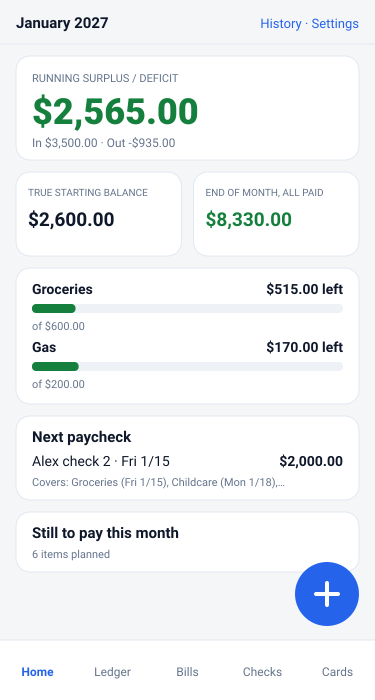
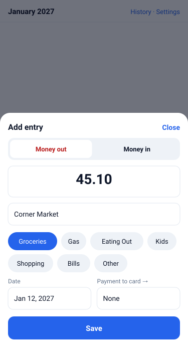
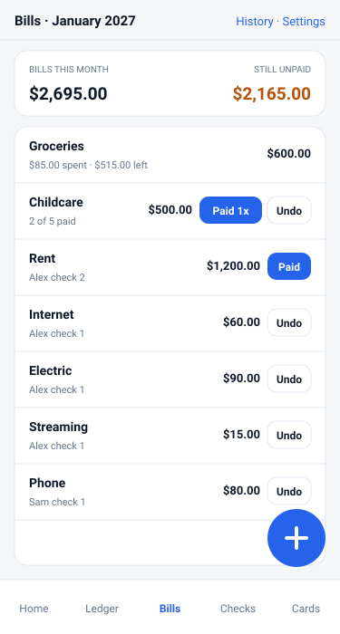
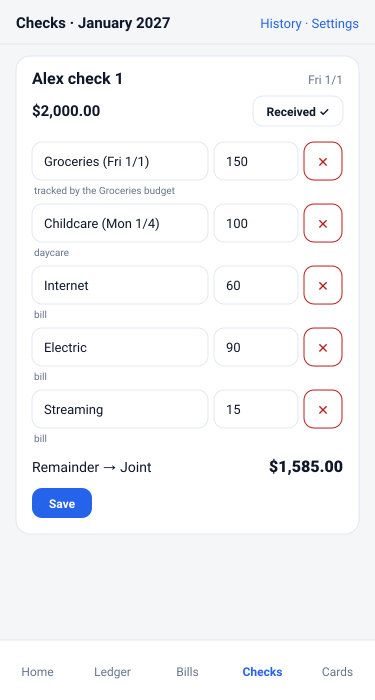
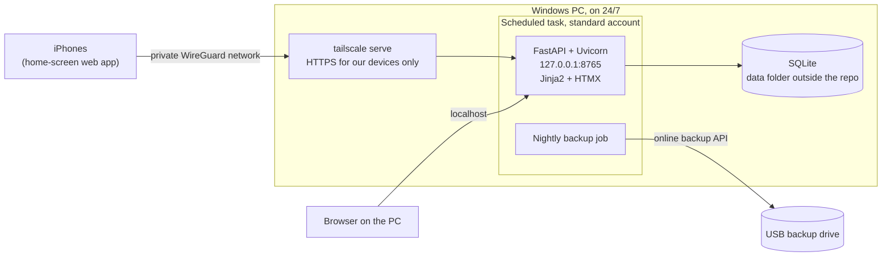

# Household Budget

[](https://github.com/Mythiicmaan/household-budget/actions/workflows/ci.yml)

A self-hosted budget app for one family. It replaced a monthly spreadsheet with fast entry from
our phones, paycheck-by-paycheck planning, and a dashboard that answers one question at a glance:
**are we spending more than we earn?**

It runs 24/7 on a Windows desktop at home and is reached only over a private
[Tailscale](https://tailscale.com) network. There are no open ports, no cloud service, no bank
logins, and no bank connections: every number is typed in by a person, on purpose.

> Everything in this repository, including the screens below, uses a **fake sample household**
> ("Alex" and "Sam"). Real data lives outside the repo and never enters it.
> See [Keeping real data out of a public repo](#keeping-real-data-out-of-a-public-repo).

<p>
  
  
  
  
</p>

## Features

- **Dashboard:** the month's running surplus or deficit, the true starting balance, a projected
  end-of-month balance with a breakdown, soft budgets, the next paycheck, everything still to pay,
  and items that haven't cleared the bank.
- **Quick add:** built for one hand and under 10 seconds. The number pad opens immediately,
  descriptions autocomplete and pick their usual category, and a double tap can't create a duplicate.
- **Paycheck plans:** each check lists what it covers, and the remainder updates live as you type.
  Checks are generated from pay schedules, including 5-Friday months, and one-off checks can be added.
- **Bills:** marking a bill paid writes its ledger entry, so nothing is entered twice. Amounts can
  change for one month or for every month after it.
- **Weekly items:** groceries follow the ledger; weekly childcare is paid one week at a time
  ("Paid 1x") at that week's own amount.
- **Start next month:** copies bills and recurring check items forward, builds the new checks, carries
  over anything that hasn't cleared, and locks the old month.
- **Cards:** a manual balance tracker. Payments logged in the ledger lower the balance automatically.
- **History, export, and undo:** charts by month, `.xlsx`/CSV export, and undo on deletes.
- **Backups:** nightly and verified, with a loud banner if they ever fail.

## Architecture



| Layer | Choice | Why |
|---|---|---|
| Web | FastAPI, Uvicorn | Small, typed, and easy to test |
| UI | Jinja2, HTMX, a little vanilla JS | Server-rendered and snappy, with no front-end build |
| Data | SQLite, SQLAlchemy 2.x, Alembic | One file, easy to back up, and the schema can evolve |
| Charts | Chart.js, vendored | Works with no CDN |
| Quality | pytest, Ruff, GitHub Actions | 190 tests, written before the UI for money math |

```text
budget/
  calc.py, money.py, schedule.py   Pure money and pay-schedule rules (no database)
  models.py, migrations/           Schema and Alembic migrations
  services/                        Business rules: ledger, bills, paychecks, months, cards
  web/, templates/, static/        Routes, pages, CSS, and small JS enhancements
  auth.py                          PIN, signed cookies, rate limit, request guards
  backup.py                        Backups, retention, and restore
  importer.py                      One-time import from the old spreadsheet
scripts/                           Install, restore, sample data, and the privacy check
tests/                             pytest suite (sample data only)
```

## How the money works

Money is stored as **integer cents**, never floats. Positive is money in; negative is money out.

| Number | Rule |
|---|---|
| Running surplus/deficit | Sum of the month's ledger entries |
| True starting balance | Bank balance on the 1st, adjusted for items that hadn't cleared |
| Check remainder | Check amount plus its (negative) lines |
| Soft budget remaining | Target plus that category's entries. It can go negative, and it never blocks anything |
| Projected end of month | Starting balance + entries so far + checks still coming − unpaid bills − unpaid check items − what's left in soft budgets |

The projection deliberately counts everything still planned, so it shows where the month actually
lands, not just the money that has arrived so far.

## Getting started

Requires Python 3.12 on Windows, macOS, or Linux. The 24/7 scripts are Windows-only.

```powershell
python -m venv .venv
.\.venv\Scripts\Activate.ps1
pip install -e ".[dev]"
pre-commit install

python scripts\make_sample_data.py          # creates .\data\sample with the fake household
$env:BUDGET_DATA_DIR = "$PWD\data\sample"
uvicorn budget.app:app --reload --host 127.0.0.1 --port 8765
```

Then open <http://localhost:8765>.

For real use, copy `config.example.toml` to `config.toml` inside your data folder and edit it. All
paths come from the `BUDGET_DATA_DIR` environment variable.

```powershell
pytest
ruff check . ; ruff format --check .
python scripts\make_readme_screens.py       # redraw the screens in this README
```

## Running 24/7 on Windows

`scripts/install.ps1`, run once from an **admin** PowerShell, sets up:

- a standard, non-admin local account (`budgetsvc`) that runs the app, with Modify rights only on the
  data and backup folders and Read on the code;
- a scheduled task that starts `python -m budget` at boot, before anyone signs in, and restarts it on
  failure;
- power settings so the PC never sleeps on AC power;
- nightly backups at 2:00 AM, keeping 30 daily and 12 monthly copies.

```powershell
powershell -ExecutionPolicy Bypass -File .\scripts\install.ps1        # set up
powershell -ExecutionPolicy Bypass -File .\scripts\check_service.ps1  # running? backups OK?
powershell -ExecutionPolicy Bypass -File .\scripts\restart.ps1        # pick up new code
powershell -ExecutionPolicy Bypass -File .\scripts\restore.ps1 <backup .db file>
powershell -ExecutionPolicy Bypass -File .\scripts\uninstall.ps1      # undo (data untouched)
```

Phones connect through Tailscale. Turn on **Run unattended** in Tailscale so the connection survives
sign-outs and reboots, enable MagicDNS and HTTPS Certificates in the admin console, then run:

```powershell
tailscale serve --bg 8765
```

## Security design

The goal was simple: this PC should not be reachable from the internet at all.

| Layer | What it does |
|---|---|
| Network | Uvicorn binds to `127.0.0.1` only. There is no port forwarding, LAN listener, or firewall rule. Phones reach it through `tailscale serve`, on our own devices only |
| Least privilege | The app runs as a standard local account with access to only the folders it needs |
| Sign-in | A shared PIN, hashed with Argon2, and an HMAC-signed `HttpOnly`, `SameSite=Lax` cookie. Wrong attempts are rate-limited |
| Desktop convenience | The PIN is skipped only for a direct localhost request. Anything carrying proxy or Tailscale headers is treated as remote, so a phone can never pass as the desktop |
| Request guards | A Host allow-list blocks DNS rebinding, same-origin checks block cross-site form posts, and a strict Content Security Policy limits scripts to the app itself |
| No bank access | No bank linking, CSV import, or stored bank credentials, by design |
| Safe parsing | The spreadsheet importer never uses `eval`; formulas go through a small arithmetic parser |
| Backups | SQLite's online backup API, integrity-checked, written to a separate drive. A missing drive fails loudly and never writes somewhere else |

## Keeping real data out of a public repo

A personal finance app is a risky thing to publish, so several independent layers would all have to
fail before anything leaked:

1. **Separation:** real data lives in a folder outside the repo, so git can't see it.
2. **`.gitignore`** blocks databases, spreadsheets, CSVs, `.env`, and `config.toml`.
3. **Sample data only:** tests, CI, and these screens use the fake household.
4. **Pre-commit hooks:** `gitleaks` scans for secrets, and `scripts/check_private_data.py` checks every
   commit, including its message, against a private deny list kept outside the repo. It also rejects
   spreadsheets and any binary file, which is why the screens above are text-based SVGs.
5. **Settings outside the code:** household values live in `config.toml` or the database, never in source.
6. **Private first:** the repo stayed private until its full history had been audited.

## What I learned

- **Separate rules from screens.** Keeping the money math in plain functions meant I could test every
  edge case, like 5-Friday months and a check that covers next month's childcare, before any UI existed.
- **Saving should only change what changed.** An early bug had saving a paycheck quietly rewrite the
  bills behind it, because the form sent every field. Real use caught what the tests hadn't.
- **Test with real workflows.** Our first projection was technically to spec and useless in practice,
  because it ignored planned spending. Using the app showed what the number had to mean.
- **Least privilege has real costs.** Running as a non-admin account meant working through batch logon
  rights, folder permissions, and what Windows hides from non-admin users. It was worth learning.
- **Reachability is a design decision.** Binding to localhost and using a private network removed whole
  categories of risk that I would otherwise have had to defend against.
- **A backup isn't real until you've restored it.** I restored one for real before calling it done.

## License

[MIT](LICENSE)
